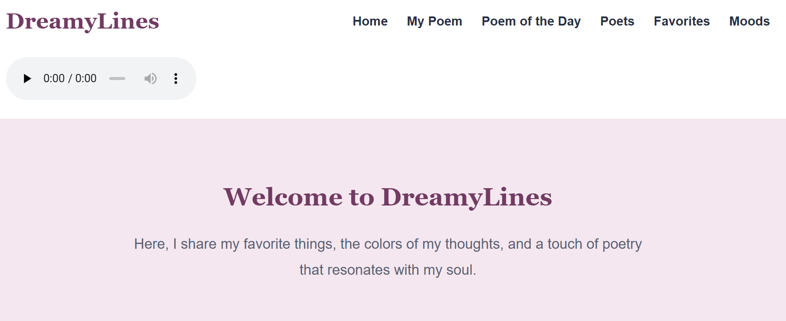
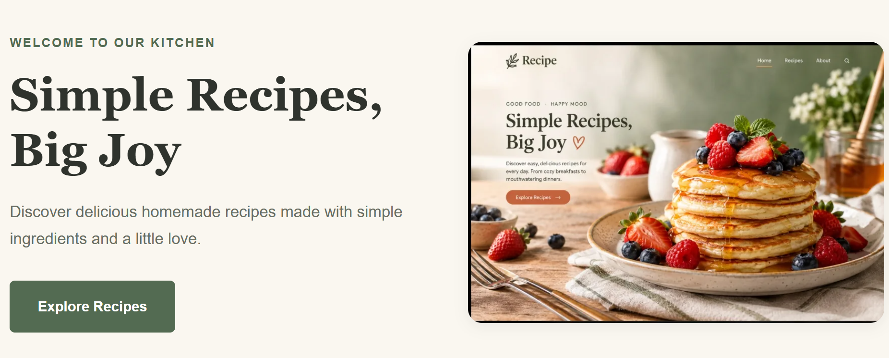
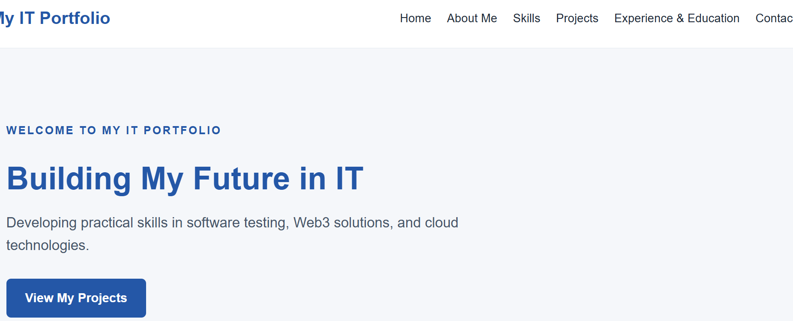
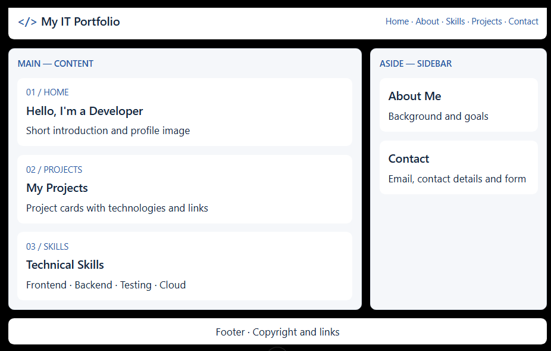
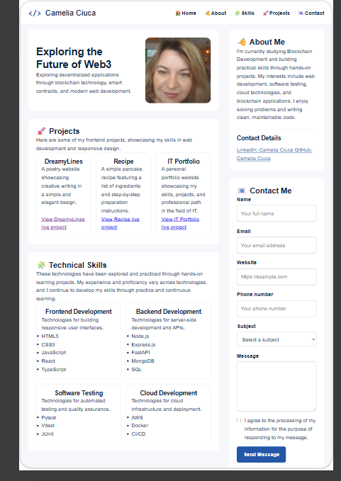
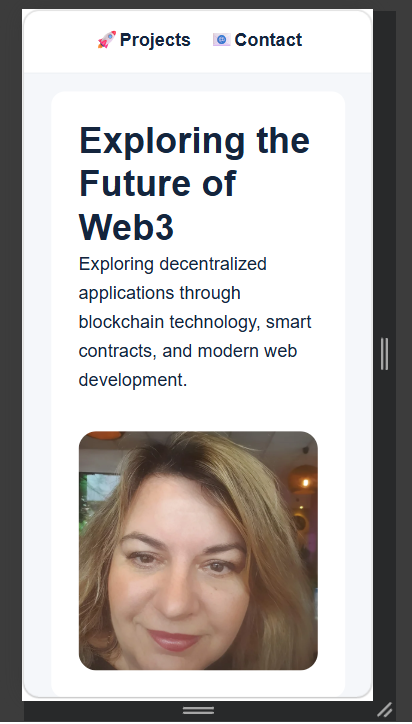
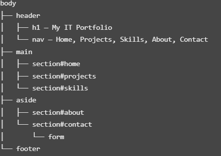
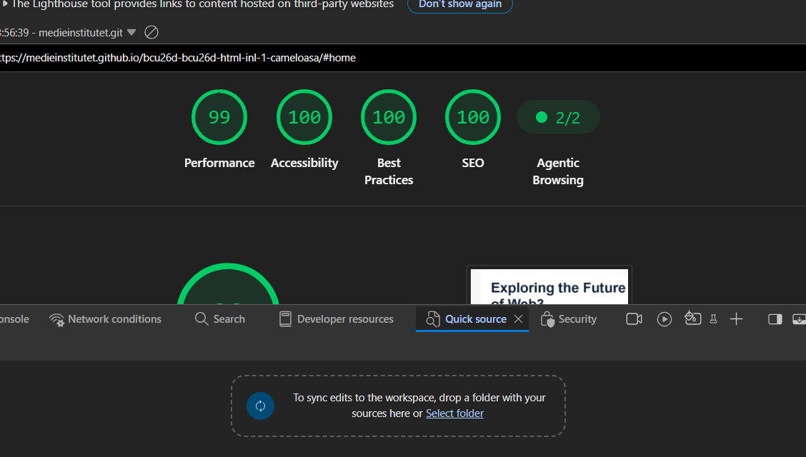
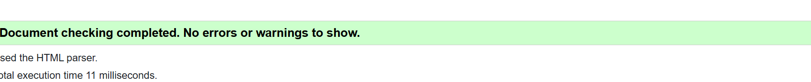

# My IT Portfolio

## Quick Links

[View Live Project](https://cameloasa.github.io/DreamyLines/)
[View Live Project](https://cameloasa.github.io/Recipe/)
[View Live Project](https://cameloasa.github.io/IT-Portofolio/)

## About the Project

This is my personal IT portfolio, created as part of my HTML and CSS learning journey. It presents my technical skills, projects, educational background, and contact information in a clean and responsive layout.

The goal is to build an accessible, well-structured website using semantic HTML and modern CSS.

## Live Projects – Screenshots

### DreamyLines

A poetry website featuring original poetry and a piano audio experience.



[View Live Project](https://cameloasa.github.io/DreamyLines/)

### Recipe

A recipe website featuring a collection of recipes, categories, and pagination.



[View Live Project](https://cameloasa.github.io/Recipe/)

### IT Portfolio

A personal portfolio showcasing web development projects and technical skills.



[View Live Project](https://cameloasa.github.io/IT-Portofolio/)

## Features

- **Responsive Layout** – adapts to desktop, tablet, and mobile screen sizes.
- **Two-Column Structure** – organizes the main content and sidebar into a clear layout.
- **Semantic HTML5** – uses semantic elements to create a meaningful and accessible page structure.
- **Navigation Menu** – provides links to the main sections of the portfolio.
- **Projects Section** – presents selected projects with links to their live versions.
- **Skills Sectionn** – highlights the technical skills demonstrated in the portfolio.
- **Contact Section** – provides contact information and an HTML form with various input types.
- **Accessible Form Elements** – includes associated labels and native HTML form validation.
- **Optimized Profile Image** – uses the WebP format to reduce image file size.
- **Open Graph Metadata** – provides information for rich link previews when the portfolio is shared on social media.

## Technologies Used

- **HTML5** – semantic page structure and form elements.
- **CSS3** – styling, layout, responsive design, and interactive states.
- **CSS Flexbox & Grid** – layout techniques for arranging page content.
- **CSS Media Queries** – responsive adjustments for different screen sizes.
- **Python 3** – used for image processing and optimization.
- **Pillow** – Python library used to resize and convert images to WebP.
- **Git & GitHub** – version control and source code management.
- **GitHub Pages** – hosting and deployment of the website.

## Design & Layout

The portfolio uses a clean, responsive two-column layout on larger screens, with the main content area and a sidebar. On smaller screens, the layout adapts to provide a comfortable browsing experience across devices.

The design features a consistent color palette, clear typography, and visual hierarchy to keep the content organized and easy to navigate.

### Website Structure



### Desktop View



### Mobile View



## Project Structure

The project follows a simple and organized folder structure, separating the website's source files, images, and deployment configuration.

```text
project/
├── .github/
│   └── workflows/
├── images/
│   ├── camelia-ciuca.webp
│   └── screenshots/
├── index.html
├── style.css
├── README.md
└── .gitignore
```

### Main Files & Directories

- **`.github/workflows/`** – contains the GitHub Actions workflow used for deployment.
- **`images/`** – stores the profile image and project screenshots.
- **`index.html`** – contains the website's HTML structure and content.
- **`style.css`** – contains the styling and responsive layout rules.
- **`README.md`** – provides project documentation.
- **`.gitignore`** – specifies files and directories that Git should ignore.

### HTML Document Structure

The HTML document is organized using semantic elements to create a clear and meaningful page structure.



## Getting Started

### 1. Clone the Repository

Clone the repository to your local machine:

```bash
git clone https://github.com/cameloasa-blockchain/Portfolio
```

### 2. Open the Project

Navigate to the project directory:

```bash
cd portfolio
```

Open the folder in Visual Studio Code or your preferred code editor.

### 3. Run the Website

Open `index.html` in your web browser to view the website.

You can also use the **Live Server** extension in Visual Studio Code for local development and automatic browser refresh when files are updated.

## Testing & Validation

### Chrome DevTools

Chrome DevTools was used to inspect HTML and CSS, troubleshoot layout issues, and test the responsive design across different screen sizes.

### Google Lighthouse

Google Lighthouse was used to evaluate the website's performance, accessibility, best practices, and SEO.



### W3C Nu HTML Checker

The W3C Nu HTML Checker was used to validate the HTML markup and identify potential errors.



## Performance & Image Optimization

### Image Optimization with Python & Pillow

Python 3 and the Pillow library were used to resize and convert the profile image from PNG to WebP format.

This reduced the image file size from approximately 12.5 MiB to 49.4 KiB, significantly reducing the amount of data required to load the image.

**Example:**

```python
from PIL import Image

with Image.open("profile-picture.png") as image:
    image.thumbnail((800, 800), Image.Resampling.LANCZOS)
    image.save("profile-picture.webp", "WEBP", quality=85, method=6)
```

### Image Loading Strategy

The profile image in the Hero section does not use `loading="lazy"` because it is visible immediately when the page loads.

As a prominent above-the-fold image and the Largest Contentful Paint (LCP) element, it should be loaded as early as possible. The `fetchpriority="high"` attribute tells the browser to prioritize fetching this image, helping improve loading performance.

For this reason, lazy loading is intentionally not applied to the profile image.

## Implementation Notes

### Contact Form

The contact form is intentionally non-functional because the assignment focuses on practicing HTML form syntax and input elements, not on implementing form submission or backend functionality.

---
