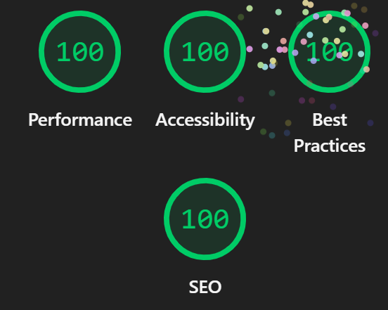

# Inlämningsuppgift
Här är repot för din inlämningsuppgift.

Om filerna:
- `.gitignore` - Denna fil används för att ignorera/exkludera vissa systemfiler som inte behöver komma med i versionshanteringen. En sådan bör man alltid ha i sitt repo.

- `index.html` - För att sidan ska kunna publiceras automatiskt på GitHub Pages är det viktigt att filen heter `index.html` med ett litet `i` i början.
- I mappen `.github` finns ett script som automatiskt publicerar sidan till GitHub Pages.
- I mappen `.github` finns även instruktioner för hur CoPilot ska ge feedback på koden.
- Det går bra att redigera denna README-fil.

## Todo:

✅ Kravlista
Här nedan ser du vad som ska finnas med i din portfolio. Sedan hur du implementerar det är upp till dig. Detta är minimikrav; det går jättebra att t.ex. ha fyra bilder.

- En **bild med** tillhörande korrekta attribut inkl. alt-text, höjd, bredd, etc.
- En **navigation/meny** (behöver ej gå att klicka på)
- En **"huvudsektion"** med själva innehållet på sidan (dvs. <main>)
- Tre **"projekt"**, dessa kan vara dummies/placeholders om du inte har någonting nu.
- Ett **sidofält** med information [<aside>]
- **Rubriker** på minst 3 nivåer (dvs [(<h1>), <h2>, <h3>)])
- En **länk** till en extern webbplats
- Sidan ska vara **responsive** dvs fungera på både mobil, tablet och desktop (dvs. ska skala "sömlöst" mellan de olika upplösningarna)
- Ett **kontaktformulär** som innehåller "kontaktsökarens": namn, e-post, webbplats, telefonnummer, en dropdown, en checkbox och ett textfält för paragraftext (textarea) och en skicka-knapp
- **Kontaktuppgifter** till dig
- En **sidfot**

## deployment

```text
 - name: Setup Pages
        uses: actions/configure-pages@v5
        with:
          # The default branch is used to determine the publishing source
          enablement: true
```

[(https://cameloasa.github.io/DreamyLines/)]
[https://cameloasa.github.io/Recipe/]
[https://cameloasa.github.io/IT-Portofolio/]

# My IT Portfolio

## About the Project

This is my personal IT portfolio, created as part of my HTML and CSS learning journey. It presents my technical skills, projects, educational background, and contact information in a clean and responsive layout.

The goal is to build an accessible, well-structured website using semantic HTML and modern CSS.

## Design Concept


The portfolio uses a two-column layout on desktop screens:

- **Main content:** Home, Projects, and Skills.
- **Sidebar (`aside`):** About Me and Contact, including a contact form.

The layout adapts to smaller screens so that the content remains readable and easy to navigate on desktops, tablets, and mobile devices.

### Color Palette

- Background: `#F5F7FA`
- Primary blue: `#2457A7`
- Dark text: `#14253D`

## Technologies Used

- HTML5
- CSS3
- CSS Grid and Flexbox
- Responsive design with media queries
- Python 3
- Pillow (Python Imaging Library) — image resizing and WebP conversion

## Planned Sections

- **Home:** Introduction and portfolio overview.
- **Projects:** Selected projects with descriptions, technologies, and repository links.
- **Skills:** Technical skills and tools.
- **About Me:** A short professional introduction and background.
- **Contact:** Contact information and a form.
- **Footer:** Copyright and relevant links.

## Learning Objectives

- Build a webpage using semantic HTML.
- Create a clear and maintainable CSS structure.
- Use CSS Grid and Flexbox for layout.
- Implement responsive design for different screen sizes.
- Follow accessibility and HTML validation best practices.
- Organize code using reusable CSS rules and design variables.

## Project Structure

```text
my-it-portfolio/
├── .github/
├── .gitignore
├── index.html
├── style.css
├── images/
└── README.md
```


The structure may evolve as the project develops.

## Getting Started

1. Clone or download this repository.
2. Open the project folder in Visual Studio Code.
3. Open `index.html` in a web browser.
4. Use Chrome DevTools to inspect and test the layout at different screen sizes.

## Project Status

The project is being developed step by step as part of my HTML and CSS studies.

## Validation & Testing Tools

- [W3C Nu HTML Checker](https://validator.w3.org/nu/) — HTML validation.
- [Google Lighthouse](https://developer.chrome.com/docs/lighthouse/overview/) — accessibility, performance, best practices, and SEO audits.
- Chrome DevTools — responsive layout and browser testing.

### Image Optimization

The profile image was resized and converted from PNG to WebP using Python and Pillow to reduce file size and improve page loading performance.

**Example:**

```python
from PIL import Image

with Image.open("profile-picture.png") as image:
    image.thumbnail((800, 800), Image.Resampling.LANCZOS)
    image.save("profile-picture.webp", "WEBP", quality=85, method=6)
```

The original image was approximately 12.5 MiB, while the optimized WebP image is only 49.4 KiB.

## Future Improvements

- Validate the HTML and CSS.

## Screenshot

 Lighthouse 

 ---
Created for learning, experimentation, and professional development.
